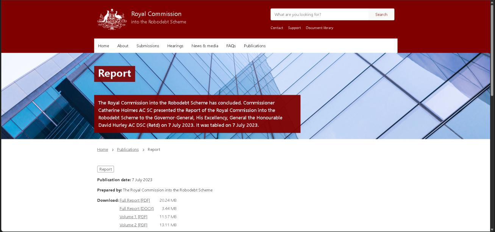
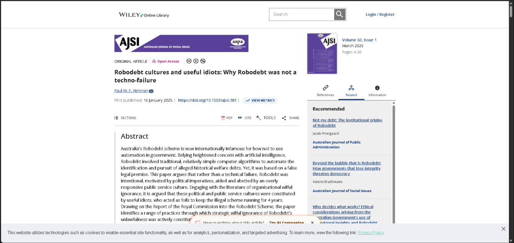
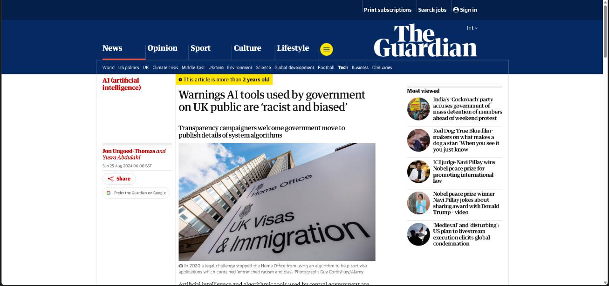
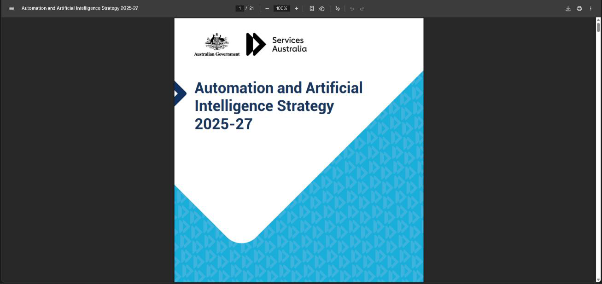
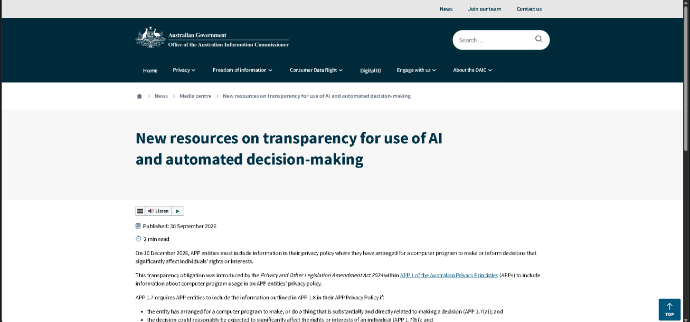
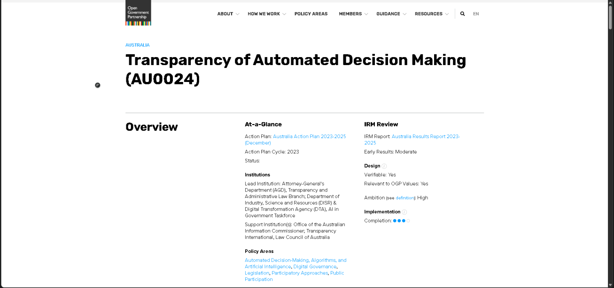

# E-Portfolio — Automated Decision Making (ADM) in Government Systems

> **Student:** S M Shahriar Alam · **ID:** 12301733 · **Campus:** Sydney
> **Tutor:** Umapathy Venugopal · **GitHub:** `shahriarRaj` · **Term:** T2 2026

---

## About this e-portfolio

This e-portfolio documents my learning this term related to Automated Decision Making (ADM) in government systems: what it is, why it's relevant to me as a future ICT professional and how it's relevant today Australian and internationally.

ADM applies algorithms (typically machine-learning models but sometimes rule-based systems) to take or greatly influence automated decisions about individuals, such as determining eligibility for welfare benefits, sorting visas, assessing the risk of child abuse, detecting tax fraud and, more recently, triaging patients. With ADM in use, governments don't only process the data – they also make decisions regarding citizens, and those decisions have state-legislated effects.

In the selection of artefacts below, each one took me forward in my thinking in some way. They form a loose circle of one disaster (Robodebt) followed by a re-framing of that disaster by the academic world (UK) followed by a policy and regulatory response within Australia, followed by transparency rules from the regulator, followed by a civil-society commitment turning all the lessons learnt into action.

### What is ADM, and why should an ICT professional care?

Decision-making by a computer system that affects a person's legal rights, entitlement or access to services is referred to as 'Automated Decision Making' (ADM). Today, within the field of government, ADM goes beyond rule-based eligibility tests (e.g. HECS repayment limits) to include algorithms rating child protections referrals for triage, estimating risk of welfare fraud, or ranking visa applications to arrive at automated decisions about merit and their outcomes (Mittelstadt 2024, p. 5).

There are 3 points that make ADM ethical, not like regular software, for an ICT professional:

- **State power.** State power is available as a backing for government action. Whether a commercial recommender system or a Centrelink algorithm, a mistake can mean a sale or losing your home, your mental health, or – as in the case of Robodebt – your life (Royal Commission into the Robodebt Scheme 2023).
- **Opacity.** It is hard to inspect the algorithmic decision by citizens and to ask questions about it and/or to appeal. When a model – that the citizen cannot read – is involved in the decision, the asymmetry of information between the state and the citizen is emphasized.
- **Scale.** The difference is that if a human caseworker is biased, it is limited to only the cases that he or she directly touches; if an algorithm is biased, it impacts every case that it touches — that's the population-level impact.

The primacy of the public interest is paramount in the ACS Code of Professional Conduct (ACS 2022), over business and personal considerations. As a developer, data scientist, or someone from a testing organization etc. directly working on government systems, I will be directly accountable to keep the systems I interact with from perpetuating or exacerbating inequities underlying the current systems. This is the reason that this e-portfolio exists.

---

## Artefact 1 — Royal Commission into the Robodebt Scheme: Final Report

**Type:** Government Report

*Figure 1. Artefact card — Government Report.*

### Justification & Reflection

The final report of the Royal Commission is the official report of the Robodebt scheme — a scheme by the Australian government to increase peoples' social-security debts through the use of an algorithm over 2015–2019. According to the report, this scheme was illegal from the start, caused serious harm to more than 400,000 vulnerable individuals and came to 56 recommendations on the issues of ADM transparency, the rule of law and mandatory review of algorithmic decisions (Royal Commission into the Robodebt Scheme 2023).

I selected this artefact, as it exposes in terrible clarity the hypnosis that comes from the moral myopia and near total blindness that is rewarded by paying attention to technical efficiency, while ignoring the other values that the ACS Code denounces as being of 'Primacy of Public Interest' (ACS 2022). Hard-core accounts of fabricated debts by people as victims kept me from using the term "algorithmic harm" as an abstract notion; instead, it became a human catastrophe for the individuals I heard from. Some of the later artefacts are a response to Recommendation 17.1 of the report which is related to a mandatory ADM transparency register. The empirical basis of each of the virtue-ethics, Kantian, Social Contract and utilitarian ethical theories during the week 4 lessons are impaired at the same time.

---

## Artefact 2 — Henman (2025): Why Robodebt was not a techno-failure

**Type:** Scholarly Article

*Figure 2. Artefact card — Scholarly Article.*

### Justification & Reflection

In his 2025 article, Henman takes another look at Robodebt and concludes that it was not a 'technical failure' to be 'patched' but a 'deliberate political project with an ideological view on welfare recipients, and [that] medical records were being used as the means for that' (2025, p. 679). All of these features were "the result of human actors who chose to employ the income-averaging methodology, suppressed internal legal advice, and ignored warnings coming from department" rather than properties of the algorithm (Henman 2025). This scheme "worked", just like the political protagonists had thought, in the sense of increasing the revenues and hurting an "unfavored" population, until, of course, it was taken down by courts and public pressure.

I selected this artefact because it encapsulated the week 4 concepts of technology being not neutral (Quinn, 2020, p. 256). The naive interpretation is 'fix the algorithm'; Henman's more profound one is 'the algorithm was used by people knowing it was flawed and bigoted against the disabled, a lack of a culture of resistance compounded by professionalism'. This is the same situation as Question 1 of this assessment; were a model to be "conforming to specification" but nonetheless to yield "prejudicial results." This heightened my awareness of my ACS Code responsibility (ACS 2022), that my responsibility isn't just my code but as part of the whole system.

---

## Artefact 3 — The Guardian (25 Aug 2024): Biased AI tools used on UK public are 'racist'

**Type:** News Article

*Figure 3. Artefact card — News Article.*

### Justification & Reflection

The UK's first public-sector AI register has been launched, and in the past, there have been several instances of biased government ADM, such as the Home Office visa "streaming" algorithm disapplied following legal challenge in 2020 by the Joint Council for the Welfare of Immigrants, and a DWP algorithm used to work out housing-benefit eligibility that inaccurately targeted many claimants (Milmo & Kale 2024). In 2024, the UK Cabinet Office conducted a review of algorithmic tools in public services which revealed that they often create discriminatory effects for disabled people, migrants and ethnic minorities.

I selected this artefact as it contextualizes the Australian circumstance as part of a worldwide trend as opposed to the Robodebt situation being a unique event. However, the same types of problems (i.e., opacity, absence of true human oversight and review, demographic bias, etc.) appear in multiple legal systems and are the same type of problem. ICT professional working in the global industrial world and can't rely on being at risk and my local government is on top of it. The article gives immediate reference to Social Contract Theory (Rawls 1971), that is no rational person would be willing behind the veil of ignorance to enter into a state that would secretly score them by ethnicity.

---

## Artefact 4 — Services Australia Automation & AI Strategy 2025-27

**Type:** Policy Document

*Figure 4. Artefact card — Policy Document.*

### Justification & Reflection

Services Australia's Automation and AI Strategy 2025-27 represents direct institutional response to the Robodebt Royal Commission from the Australian Government. The approach involves the agency using a human-centered approach; openly informing families if ADM is applied in their case; having a human case manager oversee any decision to use ADM; giving reasons in plain language; and proactively monitoring for biases (Services Australia 2025). It also pledges to create a senior governance board, which includes external members, and release a transparency register, in line with Recommendation 17.1.

The reason I selected this artefact is that it offers a glimpse into the work of the institutional ethics response, as a 'thing', and not as a press release: there is a named accountability, there is a commitment to operating as a set of practices. At the unit level, the strategy is an enacting of the ACC's Professional Competence principle (ACS, 2022) which understands the need for acknowledgment of the limits of the agency and that escalation and/or review are intrinsic to competent practice. But it isn't only correlated with the topic of Virtue Ethics in Week 4, as the method of the strategy is to embed the organizational virtues (humility, accountability, transparency) into organizational practices, rather than individual heroism. It provides me with a standard to set for what I feel what professional culture should be.

---

## Artefact 5 — OAIC — Transparency for AI & Automated Decision-Making

**Type:** Regulator Guidance

*Figure 5. Artefact card — Regulator Guidance.*

### Justification & Reflection

The OAIC's guidance for 2024 is an interpretation of the Privacy Act amendments (which became effective on 10 December 2024, with agency compliance due on 10 December 2026) that requires any APP entity (including all federal agencies) to explain in their privacy policy their use of ADM, the data used, and how individuals who are impacted can access a privacy review (OAIC 2024). There is no boilerplate to be used by agencies to meet their obligations, no generic "we may use technology" clause and the decisions must be explained to the reader in easily understood language, the guidance says.

I wanted to pick this artefact because it makes the intangible moral imperative to act transparently into one that is properly regulated and has a hard deadline for action. As an ICT worker with the distinction of being a professional, the OAIC guidance should not be misinterpreted as a soft virtue, but accords an enforceable duty, as where a regulatory action would be taken against my employers, there would also be a duty to disclose, as in the ACS Code (ACS 2022), to not be found dishonest by omission, which is professionally censure. It also goes back to mandatory disclosure which alters the information asymmetry available and allows citizens to challenge bad decisions, thereby minimizing the overall harm arising from ADM.

---

## Artefact 6 — Open Government Partnership Australia — AU0024 Commitment

**Type:** Civil Society Commitment

*Figure 6. Artefact card — Civil Society Commitment.*

### Justification & Reflection

The actions of the regulator and agency captured in Artefacts 4 and 5 have a related civil-society facing action captured in the Open Government Partnership's AU0024 action. It does so by putting into place Recommendation 17.1 of the Robodebt Royal Commission which is a public machine-readable register that makes transparent where the Australian Government uses ADM, the outcomes of the system, the data that underlie these decisions, and how citizens can raise their concerns for review (OGP 2024). It is co-designed with civil-society organizations the Australian Privacy Foundation, Digital Rights Watch and Human Rights Law Centre, and assessed by reporting against measurable, published milestones.

The artefact that I selected is one that exemplifies a different way of ethical action, unlike the other artefacts described herein, a way that is not based on the top-down approach of regulation but rather co-design of civil society and state. Unit wise, it is simply the purest instance of Social Contract Theory in practice in this portfolio, the rules for ADM, being negotiated in public between the people the state acts on and the state itself, just as Rawls (1971) would have it. For me as an ICT professional I am reminded of my obligation of the ACS Code (ACS 2022) not only to follow laws, but also to have a say in law making, which the ACS Code terms Professional Development.

---

## Synthesis — what I learned this term

If I focus on the six artefacts, I can see four lessons that for me, as a future ICT professional, will be important:

- **Algorithmic harm is harm done by humans.** Robodebt was NOT a software bug, it was a politically driven software project. Finally, because all these choices on an algorithm made by the government are 'technical' choices, they are choices about which citizens matter and how much (Henman 2025).
- **The pattern is valid on an international level.** The UK cases (Milmo & Kale 2024) and the Dutch SyRI / childcare benefits scandal illustrate that Robodebt is not an "Australia-only incidence." As the UK cases (Milmo & Kale 2024) and DOI SyRI / childcare benefits scandal reveal, Robodebt is not an "Australia-only incidence."
- **Institutional responses are also beginning to take place — albeit slowly.** There is clear evidence the post-Robodebt guardrails will be created: Services Australia's 2025. The post-Robodebt guardrails are being drawn up: Services Australia's 2025 strategy, the OAIC's transparency rules and the OGP AU0024 commitment. They are only at an early stage of development and aren't yet consistently implemented.
- **There's always a professional to be the last line of defense.** Where the law is not up-to-date or law enforcement is under pressure, the individual ICT professional = be it someone guided by something such as the ACS Code (ACS 2022) – raises the bias concern or not. It's what is going on in question 1 of this assessment and that's why I picked A.

These four lessons are the "glue" holding me together between the two points I had above (algorithms are neutral tools and algorithms are social artefacts and I have a job to build them something ethical).

---

## Reference List

- Australian Computer Society (ACS) 2022, *Code of Professional Conduct*, version 2.1, ACS, Sydney, NSW, viewed 10 October 2026, <https://www.acs.org.au/content/dam/acs/rules-and-regulations/Code-of-Professional-Conduct_v2.1.pdf>.
- Henman, P 2025, 'Why Robodebt was not a techno-failure', *Australian Journal of Social Policy*, viewed 10 October 2026, <https://doi.org/10.1002/ajs4.383>.
- Milmo, D & Kale, S 2024, 'Warnings AI tools used by government on UK public are "racist"', *The Guardian*, 25 August, viewed 10 October 2026, <https://www.theguardian.com/technology/article/2024/aug/25/register-aims-to-quash-fears-over-racist-and-biased-ai-tools-used-on-uk-public>.
- Mittelstadt, B 2024, 'Principles for the ethical design of automated decision systems in government', *Government Information Quarterly*, vol. 41, no. 3, article 101934.
- Office of the Australian Information Commissioner (OAIC) 2024, *New resources on transparency for use of AI and automated decision-making*, OAIC, Sydney, viewed 10 October 2026, <https://www.oaic.gov.au/news/media-centre/new-resources-on-transparency-for-use-of-ai-and-automated-decision-making>.
- Open Government Partnership (OGP) 2024, *Transparency of Automated Decision Making (AU0024)*, OGP, viewed 10 October 2026, <https://www.opengovpartnership.org/members/australia/commitments/AU0024>.
- Quinn, M 2020, *Ethics for the information age*, 8th edn, Pearson, Boston, MA.
- Rawls, J 1971, *A theory of justice*, Harvard University Press, Cambridge, MA.
- Royal Commission into the Robodebt Scheme 2023, *Royal Commission into the Robodebt Scheme: Final report*, Commonwealth of Australia, Canberra, ACT, viewed 10 October 2026, <https://robodebt.royalcommission.gov.au/final-report>.
- Services Australia 2025, *Automation and Artificial Intelligence Strategy 2025-27*, Australian Government, viewed 10 October 2026, <https://www.servicesaustralia.gov.au/sites/default/files/2025-05/automation-and-ai-strategy-2025-27.pdf>.
